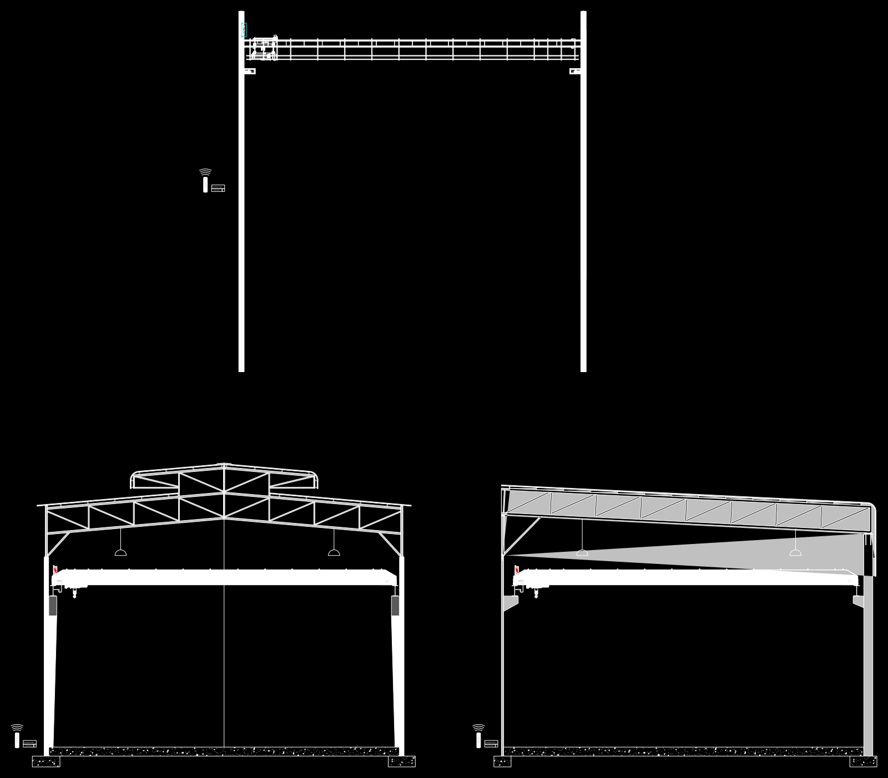

# jDwgParser

Java로 구현한 AutoCAD DWG 파일 파서 라이브러리.

Open Design Specification for .dwg files v5.4.1을 기반으로 R13부터 R2018까지의 DWG 파일을 읽습니다. 외부 의존성이 없는 순수 Java 라이브러리이며 Java 11 이상에서 동작합니다. 쓰기(`DwgWriter`)는 아직 개발 중입니다.

## 변환 예

아래 그림은 공개된 DWG 도면을 jDwgParser의 변환 명령으로 PNG로 바꾼 결과입니다. 손대지 않은 그대로입니다.

```sh
java -jar jdwgparser-0.1.0.jar drawing.dwg drawing.png --size 1600
```

<table>
<tr>
<td width="47%"></td>
<td></td>
</tr>
<tr>
<td>주택 평면도: 치수, 문자, 해치, 블록(가구·위생기구)<br>AutoCAD 2018 형식 · <a href="https://blocks.draftsperson.net/download/bulacan-three-bedroom-house-floor-plan/">원본 도면</a></td>
<td>천장 크레인 창고: 트러스, 채움 영역, 해치<br>AutoCAD 2018 형식 · <a href="https://blocks.draftsperson.net/download/overhead-travelling-crane-in-shed/">원본 도면</a></td>
</tr>
<tr>
<td colspan="2"></td>
</tr>
<tr>
<td colspan="2">보행자 현수교 입면도와 배치도: 나무 블록, 치수, 선 종류<br>AutoCAD 2000 형식 · <a href="https://blocks.draftsperson.net/download/pedestrian-suspension-bridge-over-river/">원본 도면</a></td>
</tr>
</table>

도면 출처: [blocks.draftsperson.net](https://blocks.draftsperson.net/) ([이용 조건](https://blocks.draftsperson.net/license/)). DWG 파일은 이 저장소에 포함하지 않으니, 원본 도면 링크에서 받으세요.

## 명령 한 줄로 변환

DWG 파일을 PNG, SVG, PDF로 바꿉니다. Java 11 이상만 있으면 됩니다.

```
java -jar jdwgparser.jar <입력.dwg | 입력폴더> [출력] [옵션]
java -jar jdwgparser.jar merge <이름.tiles> [출력.png]
```

### 자주 쓰는 예

```sh
java -jar jdwgparser.jar drawing.dwg                          # drawing.png (도면의 용지 크기, 300dpi)
java -jar jdwgparser.jar drawing.dwg out.pdf                  # 형식은 출력 확장자로 (png, svg, pdf)
java -jar jdwgparser.jar drawing.dwg --scale 1/4              # 기본 크기의 1/4로 축소
java -jar jdwgparser.jar drawing.dwg --dpi 150                # 용지 크기, 150dpi
java -jar jdwgparser.jar drawing.dwg --size 4000              # 긴 변 4000픽셀
java -jar jdwgparser.jar drawing.dwg --background white       # 흰 바탕에 검은 선
java -jar jdwgparser.jar drawings/ images/                    # 폴더 안의 모든 .dwg (하위 폴더 포함)
java -jar jdwgparser.jar drawing.dwg --px-per-unit 1 --split  # 원본 크기(1단위 = 1픽셀)를 조각으로
java -jar jdwgparser.jar merge drawing.tiles                  # 조각을 한 장의 drawing.png로
```

### 출력 위치

| 출력 인자 | 결과 |
|---|---|
| 생략 | 입력 파일 옆에 같은 이름의 `.png`. 예: `drawing.dwg` → `drawing.png` |
| 파일 (`out.png`, `out.svg`, `out.pdf`) | 그 파일. 형식은 확장자로 정합니다 |
| 폴더 | 그 폴더 안에 같은 이름으로. 입력이 폴더면 하위 폴더 구조를 그대로 둡니다 |

`--format png|svg|pdf`로 형식을 직접 정할 수도 있습니다.

### 크기

먼저 크기 기준을 하나 정합니다. 아무것도 주지 않으면 `--dpi 300`입니다.

| 옵션 | 뜻 |
|---|---|
| `--dpi N` | 도면(모형 공간 배치)에 저장된 용지 크기에 N dpi로 맞춥니다. 용지 정보가 없는 도면에 이 옵션을 주면 오류입니다 |
| `--px-per-unit N` | 도면 1단위당 N픽셀. `1`이면 도면의 원래 크기(1단위 = 1픽셀)입니다 |
| `--size N` | 긴 변을 N픽셀로 맞춥니다 |

용지 정보가 없는 도면은 기본값이 `--px-per-unit 1`입니다.

그다음 `--scale F`로 축소(또는 확대)할 수 있습니다. 위에서 정한 크기에 F를 곱합니다.
- **값:** `1/2`, `1/4`, `1/8`, `1/16`처럼 분수로, 또는 `0.3`처럼 소수로 씁니다. 0보다 크고 64 이하입니다.
- **여백:** 같은 비율로 줄어듭니다.
- **메모리:** PNG 메모리는 F의 제곱으로 줄어서, 1/4이면 1/16만 씁니다.

예를 들어 A4 용지 도면은 기본이 3508×2145px입니다. `--scale 1/4`이면 877×537px, `--scale 1/16`이면 219×134px입니다.

### 큰 PNG: 한 장 또는 분할

| 방식 | 장점 | 단점 |
|---|---|---|
| 한 장 (기본) | 빠름 | 이미지 전체(가로 × 세로 × 4바이트)가 메모리에 있어야 함 |
| 분할 (`--split`) | 이미지 크기와 상관없이 메모리가 적음 | 띠마다 도면을 다시 훑으므로 띠가 많으면 느림 |

16000×12807px PNG를 한 장으로 만들면 힙이 약 1GB 필요합니다. `--split`은 64MB, `merge`는 32MB면 됩니다.

한 장 모드에서 메모리가 모자랄 것 같으면, 그리기 전에 멈추고 `--split`이나 `--scale`을 쓰라고 알립니다. 힙을 늘리려면 `java -Xmx2g -jar ...`처럼 실행합니다.

**분할(`--split`)**
- `--tile N`(기본 2048)픽셀 조각으로 나눠 저장합니다. 마지막 줄과 칸의 조각은 더 작을 수 있습니다.
- 조각 이름은 `이름[가로번호x세로번호].png`이고 번호는 1부터 셉니다. 예: `drawing[1x1].png`, `drawing[2x3].png`(왼쪽에서 두 번째, 위에서 세 번째).
- 조각과 함께 `이름.tiles` 파일이 생깁니다. 전체 크기와 조각 수가 적혀 있습니다.

**합치기(`merge`)**
- `merge 이름.tiles [출력.png]`로 조각을 한 장의 PNG로 합칩니다. 출력을 생략하면 `이름.png`입니다.
- 한 줄씩 읽고 써서 메모리가 적게 들고, Java 이미지 크기 제한(한 변 약 46,000px)도 받지 않습니다.

SVG와 PDF는 크기와 상관없이 메모리가 같으므로 분할이 필요 없습니다.

### 그 밖의 옵션

| 옵션 | 뜻 |
|---|---|
| `--background black\|white` | 바탕색. 기본은 검정이고, `white`면 흰 바탕에 검은 선입니다 |
| `--max-mb N` | 파일 하나를 읽을 때 쓸 수 있는 메모리 상한(MB) |
| `-h`, `--help` | 사용법 |
| `--version` | 버전 한 줄(버전, 빌드 시각, Java, OS) |

### 결과와 종료 코드

파일마다 한 줄로 결과를 알립니다.

```
ok      drawing.dwg -> drawing.png (877x537 px, paper 210 x 297 mm at 300 dpi x 1/4, 1327 ms)
failed  broken.dwg: ...
```

| 종료 코드 | 뜻 |
|---|---|
| 0 | 모두 성공 |
| 1 | 일부 또는 전부 실패 |
| 2 | 인자 오류 |

### 메모리

변환은 객체를 읽는 대로 그림 모델로 넘기고, 문서 전체는 들고 있지 않습니다. 기본 크기 기준으로 14MB 도면도 `-Xmx111m`으로 변환됩니다. 자세한 측정값은 [RELIABILITY.md](RELIABILITY.md)에 있습니다.

## 버전과 버그 보고

지금 버전은 **0.1.0**입니다. 버전 규칙(`주.부.수`)과 출시 절차는 [VERSIONING.md](VERSIONING.md)에, 버전별 변경은 [CHANGELOG.md](CHANGELOG.md)에 있습니다.

```sh
java -jar jdwgparser-0.1.0.jar --version
# jDwgParser 0.1.0 (built 2026-11-26 08:18 UTC; Java 21.0.10; Windows 11 10.0 aarch64)
```

Java API에서는 `io.dwg.api.Version.describe()`가 같은 줄을 돌려줍니다.

버그를 알려 주실 때는 다음을 보내 주세요.
1. 위의 버전 줄. 변환이 실패하면 명령이 마지막에 이 줄을 출력합니다.
2. 실행한 명령 전체(옵션 포함)와 출력된 `failed ...` 메시지
3. 가능하면 도면 파일. 어렵다면 DWG 버전과 파일 크기
4. 기대한 결과와 실제 결과

## 빠른 시작 (Java API)

```java
DwgDocument doc = DwgReader.defaultReader().open(Paths.get("drawing.dwg"));
for (DwgLine line : doc.objects(DwgLine.class)) {
    System.out.println(line.start() + " -> " + line.end() + " on " + doc.layerOf(line).map(DwgLayer::name).orElse("?"));
}
doc.issues().forEach(System.out::println);   // 읽지 못한 부분이 있으면 여기에 나옵니다
```

- `open()`은 문서를 돌려주거나 `DwgReadException`을 던집니다. 지원하지 않는 버전, 구조가 깨진 파일, 상한 초과일 때입니다.
- 일부만 깨진 파일은 나머지를 읽고, 깨진 부분은 `issues()`로 알려 줍니다.
- 상한은 `maxBytes(long)`와 `timeout(Duration)`으로 정합니다. 자세한 내용은 [RELIABILITY.md](RELIABILITY.md)에 있습니다.
- 이 예제는 `QuickStartTest`가 그대로 실행해 확인합니다.

## 프로젝트 구조

```
src/
├── io/dwg/
│   ├── core/          # 저수준 I/O, 버전 감지, 유틸리티
│   │   ├── io/        # BitStream 읽기/쓰기
│   │   ├── type/      # DwgHandle, Point3D 등
│   │   ├── util/      # LZ77, CRC, 문자열 인코딩
│   │   └── version/   # DwgVersion, 버전 감지
│   │
│   ├── format/        # 버전별 파일 구조 핸들러
│   │   ├── common/    # 공통 인터페이스
│   │   ├── r13/       # R13-R15 구현
│   │   ├── r2004/     # R2004 구현
│   │   └── r2007/     # R2007-R2010 구현
│   │
│   ├── sections/      # 섹션 파서/라이터
│   │   ├── header/    # Header 변수
│   │   ├── classes/   # 클래스 정의
│   │   ├── handles/   # 핸들 맵
│   │   └── objects/   # 엔티티/객체
│   │
│   ├── entities/      # 도메인 모델 (순수 데이터)
│   │   ├── concrete/  # Line, Circle, Arc, Text 등
│   │   └── ...
│   │
│   ├── api/           # 고수준 공개 API
│   │   ├── DwgReader
│   │   ├── DwgWriter
│   │   └── DwgDocument
│   │
│   └── test/          # DwgParsingStageTest (단계별 진단 도구)
test/                  # JUnit 테스트, 측정 도구(tools), 벤치마크(bench)
```

## 아키텍처

### 모듈 계층도

```
dwg-core → dwg-format → dwg-sections → dwg-entities → dwg-api
```

| 모듈 | 책임 |
|------|------|
| `dwg-core` | 비트스트림 I/O, 타입, LZ77/CRC |
| `dwg-format` | 버전별 파일 구조 (R13~R2018) |
| `dwg-sections` | 섹션 파서/라이터 |
| `dwg-entities` | 순수 데이터 모델 (엔티티+비엔티티) |
| `dwg-api` | 공개 API (DwgReader, DwgWriter) |

### 주요 패턴

- **Strategy**: `DwgFileStructureHandler` — 버전별 파싱 전략
- **Factory**: `DwgFileStructureHandlerFactory` — 버전에 맞는 핸들러 선택
- **Registry**: `SectionParserRegistry` — 섹션 이름 → 파서 매핑
- **Builder**: `DwgReader`, `DwgDocument` — Fluent API

## 구현 단계 및 완료 상태

### ✅ Phase 2-9 완료 (v0.1.0)

**Phase 2: 기초 구현** ✓
- BitStream I/O (읽기/쓰기), DWG 타입, 버전 감지, LZ77/CRC

**Phase 4: R2000 지원** ✓
- R2000 HeaderVariables, 섹션 파싱 (22개 샘플 파일 100% 통과)

**Phase 5: R2004 엔티티 해석** ✓
- Objects 섹션 비트 단위 파싱, 64개 엔티티 리더 구현

**Phase 6A: R2007/R2010/R2013/R2018 기초** ✓
- R2007 Reed-Solomon 헤더, PageMap/SectionMap 추출
- R2010+ 파일 구조 인식

**Phase 6B: Objects 섹션 추출** ✓
- R2007 RS(255,239) 복호화 및 LZ77 해제
- Objects 섹션 197KB+ 추출 (18개 샘플 100%)

**Phase 7: 완전 통합 및 검증** ✓
- Handles 오프셋 계산 수정 (blockCount 8바이트 정렬)
- 순차 파싱 폴백 구현
- 4,816 엔티티 추출 (+42% 개선)

**Phase 8: 엔티티 타입 확장** ✓
- 74개 엔티티 타입 구현 (완전 커버리지)
- 19개 신규 타입 추가 (MLINE, MTEXT, WIPEOUT, IMAGE 등)

**Phase 9 Tier 1: R2004 LZ77 수정** ✓
- R2004 전용 LZ77 디컴프레서 구현 (+42% 개선, 645개 추가 엔티티)

**Phase 9 Tier 3: R2010+ 라우팅 수정** ✓
- 아키텍처 버그 발견: R2010/R2013/R2018은 R2004 파일 구조 사용
- R2007 핸들러 대신 R2004 핸들러로 라우팅 변경
- Reed-Solomon 디코더 단순화 (deinterleave만, BM 에러정정 제거)
- 엔티티 추출 **6,825 → 12,756 (+87%)**

### 📊 최종 성과

2026-11-26 측정 ([RELIABILITY.md](RELIABILITY.md)에 방법과 자세한 결과):

| 메트릭 | 결과 |
|--------|------|
| R13~R2018 샘플 도면 | 233/233 열림 |
| 읽은 객체 | 2,244,417개, 읽기 점검에서 문제가 있는 객체 0개 |
| 손상 파일 퍼징 | 6,000회: 문서를 돌려주거나 `DwgReadException`, 그 밖의 예외·시간 초과·메모리 부족 0 |
| 읽기 속도 | 평균 약 25 MB/s |

### 🎯 Phase 10 (계획)

- 성능 최적화 (일부 R2018 파일 순차 파싱 폴백)
- R13/R14 완전 지원
- 보조 섹션 파서 확장 (AppInfo, Preview, XData)
- 쓰기 기능 (Phase 3)

## 빌드 및 실행

### 요구사항

- Java 11+
- Maven 3.6+

### 빌드

```bash
mvn clean package               # 테스트를 돌린 뒤 jar를 만듭니다
mvn clean package -DskipTests   # 테스트 없이 jar만
```

- **jar:** `target/jdwgparser-0.1.0.jar`가 생깁니다. 실행 클래스가 들어 있어 위의 [명령 한 줄로 변환](#명령-한-줄로-변환)에 그대로 씁니다. 실행에 필요한 다른 라이브러리는 없습니다.
  ```bash
  java -jar target/jdwgparser-0.1.0.jar drawing.dwg
  ```
- **다른 프로젝트에서 쓰기:** 이 jar를 클래스패스에 넣으면 됩니다. 모듈 이름은 `io.dwg`입니다.
- **컴파일만:** `mvn clean compile`이면 `target/classes`에 클래스 파일만 만듭니다.

### 테스트

```bash
mvn test
mvn test -Ddwg.samples=/path/to/samples   # 샘플 폴더가 다른 곳에 있을 때 (또는 환경 변수 DWG_SAMPLES)
```

테스트는 샘플 도면을 씁니다. 기본으로 작업 폴더의 `samples`를 찾고, 없으면 샘플이 필요한 테스트는 건너뜁니다.

### 단계별 파싱 테스트

```bash
# Windows
run_test.bat path/to/sample.dwg

# macOS/Linux
./run_test.sh path/to/sample.dwg

# 직접 실행
mvn compile
java -cp target/classes io.dwg.test.DwgParsingStageTest path/to/sample.dwg
```

자세한 테스트 가이드는 [TESTING.md](TESTING.md) 참조.

### 렌더링으로 눈으로 확인

`DwgReader`로 읽은 도면의 모델 스페이스를 PNG로 그려 결과를 직접 확인할 수 있습니다. R13부터 R2018까지 그릴 수 있습니다. R2000은 별도 기준 리더와 대조했고, 나머지 버전은 같은 도면의 R2000 판과 같은 그림이 나오는지로 확인했습니다. R12 이하는 지원하지 않습니다.

```bash
mvn compile
java -cp target/classes io.dwg.render.tool.RenderTest              # samples/2000 전체 → target/render
java -cp target/classes io.dwg.render.tool.RenderTest path/to/file.dwg out
```

출력 읽는 법과 지원 범위는 [RENDERING.md](RENDERING.md) 참조.

## Phase 9 Tier 3 핵심 발견사항

### 아키텍처 버그 (R2010+ 파일 라우팅)

**문제**: R2010, R2013, R2018 파일이 0개 엔티티 추출 (완전 실패)

**근본 원인**: 파일 구조 라우팅 오류. 스펙 6~8장에 따르면 R2010, R2013, R2018의 파일 헤더, 페이지 맵, 섹션 맵, 압축은 R2004와 같다.

**발견**: R2010, R2013, R2018은 R2004 파일 구조 사용
- R2007은 유일하게 Reed-Solomon(255,239) 헤더 암호화 사용
- R2010+는 R2004 방식 (XOR 암호화 + LZ77)

**해결**: 파일 라우팅 변경
```java
// Before: R2010/R2013/R2018 → R2007FileStructureHandler (XOR 구조로 RS 읽으려다 실패)
// After: R2010/R2013/R2018 → R2004FileStructureHandler (올바른 구조)

case R2004: case R2010: case R2013: case R2018:
    return new R2004FileStructureHandler();
case R2007:
    return new R2007FileStructureHandler();
```

**보너스 발견**: Reed-Solomon 디코더 단순화
- 디코더를 스펙 §5.13의 deinterleave 전용으로 단순화 (샘플 R2007 데이터 블록 303,887개에 오류가 있는 블록이 없음)
- 이전 Berlekamp-Massey 에러 정정 제거

**결과**: 
- R2010+ 성공률: 7% → 100%
- 추출 엔티티: 6,825 → 12,756 (+87%)

### 핵심 교훈

알고리즘 버그로 보이는 문제를 조사할 때는 먼저 알고리즘이 올바른 입력을 받는지 확인하세요. 이 경우 알고리즘 자체는 정상이었지만 잘못된 파일 구조로 라우팅되어 있었습니다.

## 사용 예시

### 기본 사용법

```java
import io.dwg.api.DwgReader;
import io.dwg.api.DwgDocument;
import io.dwg.entities.DwgEntity;
import java.nio.file.Paths;
import java.util.List;

// DWG 파일 읽기
DwgDocument doc = DwgReader.defaultReader()
    .open(Paths.get("drawing.dwg"));

// 문서 정보
System.out.println("버전: " + doc.version());
System.out.println("객체 수: " + doc.objectMap().size());

// 레이어 조회
doc.layer("0")
    .ifPresent(layer -> System.out.println("0 레이어 색상: " + layer.color()));

// 엔티티 조회
List<DwgEntity> entities = doc.entities();
for (DwgEntity e : entities) {
    System.out.println(e.objectType() + " at handle 0x" + Long.toHexString(e.handle()));
}
```

## v0.1.0 버전 지원 현황

| 버전 | 샘플 | 열림 | 객체 | 문제가 있는 객체 |
|------|------|------|------|-----------------|
| R13 | 1 | 1 | 5,785 | 0 |
| R14 | 4 | 4 | 1,550 | 0 |
| R2000 | 34 | 34 | 54,016 | 0 |
| R2004 | 29 | 29 | 163,136 | 0 |
| R2007 | 98 | 98 | 1,611,090 | 0 |
| R2010 | 19 | 19 | 4,294 | 0 |
| R2013 | 27 | 27 | 353,156 | 0 |
| R2018 | 21 | 21 | 51,390 | 0 |

2026-11-26 측정. R12 이하는 지원하지 않습니다. 자세한 내용은 [RELIABILITY.md](RELIABILITY.md)를 보세요.

### 지원 엔티티 타입 (74개)

**기하학 엔티티 (30개)**
- 2D: LINE, CIRCLE, ARC, POLYLINE, LWPOLYLINE, SPLINE, ELLIPSE, TEXT, MTEXT
- 3D: 3DFACE, 3DPOLYLINE, REGION, SOLID, TRACE, SHAPE, MULTILEADER, ARC_DIMENSION
- 특수: HATCH, IMAGE, UNDERLAY, WIPEOUT, SURFACE, MESH, MLINE

**객체 및 제어 (44개)**
- LAYER, LINETYPE, STYLE, DIMSTYLE, APPID, UCS, VIEW, VPORT
- 제어 객체: BLOCK_CONTROL, ENDBLK, INSERT
- 속성: XREF, ATTRIB, ATTDEF
- 테이블: TABLE, SCALE_LIST, TABLESTYLE, CELLSTYLE, PLOTSTYLE
- 데이터: DICTIONARY, DICTIONARYVAR, LAYOUT, MATERIAL, DATASOURCE
- 기타: TOLERANCE, LEADER, OLE2FRAME, PROXY, PERSSUBENTMANAGER

## 단계별 파싱 흐름

```
[파일 읽기] → [버전 감지] → [헤더 파싱] → [섹션 추출] 
    ↓              ↓               ↓            ↓
 1단계         2단계          3단계        4단계

[섹션 파싱] → [객체 생성] → [DwgDocument] → [API 사용]
    ↓              ↓            ↓            ↓
  5단계         5단계        6단계        최종
```

각 단계는 독립적으로 테스트 가능합니다 ([DwgParsingStageTest](src/io/dwg/test/DwgParsingStageTest.java) 참고).

## 주요 클래스

### API 계층

- `DwgReader` — 파일 읽기
- `DwgWriter` — 파일 쓰기
- `DwgDocument` — 파싱된 문서

### 핵심 도메인

- `DwgObject` — 모든 객체의 기본 인터페이스
- `DwgEntity` — 도형 엔티티
- `DwgVersion` — 버전 열거 및 버전 비교
- `HeaderVariables` — 헤더 변수 (500+개)
- `HandleRegistry` — 핸들 → 오프셋 매핑

### 저수준 I/O

- `BitStreamReader` — 비트 단위 읽기
- `BitStreamWriter` — 비트 단위 쓰기
- `ByteBufferBitInput` — 버퍼 기반 입력
- `ByteBufferBitOutput` — 버퍼 기반 출력

## 라이선스

GNU General Public License v3.0 (see [LICENSE](LICENSE))

## 참고 자료

- [OpenDesign Specification](https://www.opendesign.com/guestdownloads) — 공식 스펙
- AutoCAD DWG 포맷 위키
- Autodesk 공식 문서

## 기여

이슈 및 PR을 환영합니다.

## 개발 팀

- Initial design: ebandal
- Contributors: 커뮤니티 (현재)
