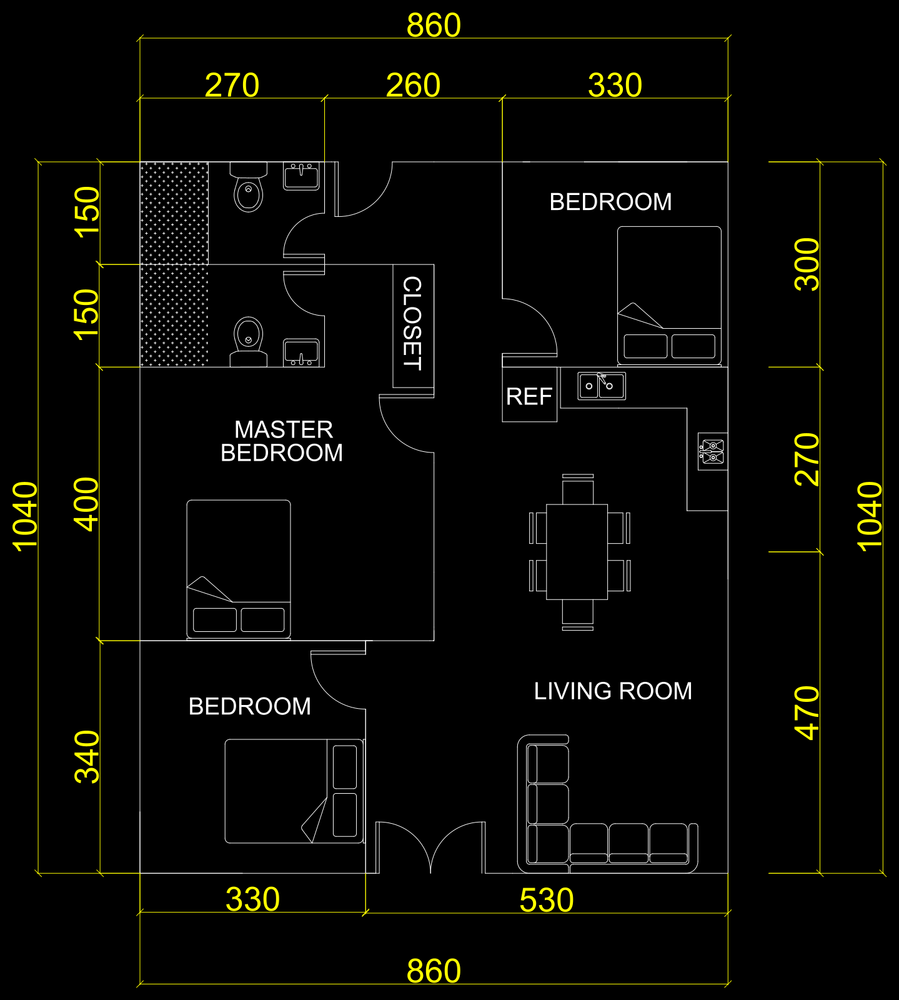
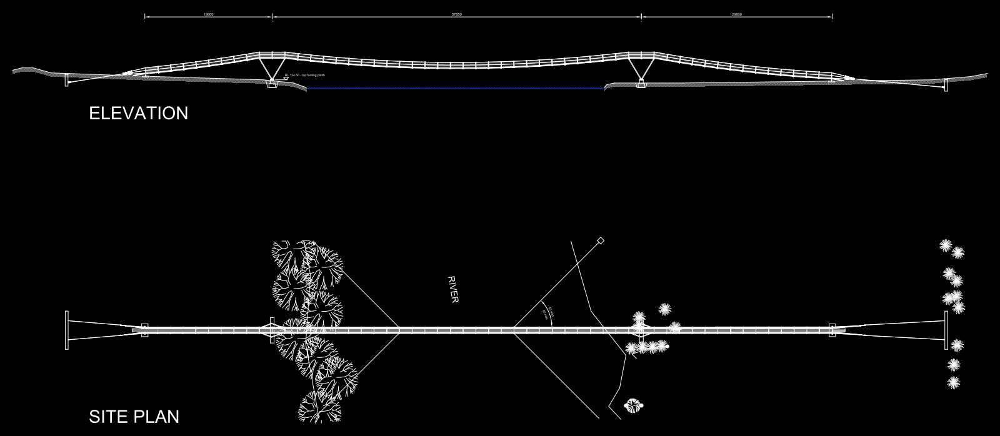

# jDwgParser

**한눈에 보기**
- **무엇:** AutoCAD DWG 도면(R13~R2018)을 읽어 PNG, SVG, PDF로 바꾸는 순수 Java 도구이자 라이브러리입니다. AutoCAD가 필요 없습니다.
- **실행 환경:** Java 11 이상이면 Windows, Linux, macOS 어디서나 돕니다. 외부 의존성은 없습니다.
- **명령 한 줄:** `java -jar jdwgparser-0.1.0.jar drawing.dwg`로 `drawing.png`를 만듭니다. 프로그램이 읽을 결과가 필요하면 `--json`을 붙입니다.
- **받기:** 저장소의 Releases에서 jar와 SHA-256 체크섬을 받거나, `mvn package`로 직접 빌드합니다.
- **라이선스:** 비영리 사용은 무료입니다. 기업 등 영리 목적의 사용은 상용 라이선스가 필요합니다(연 US$490 또는 1회 US$1,490, 30일 평가 가능). 자세한 내용은 [LICENSING.md](LICENSING.md)에 있습니다.

> **In English:** jDwgParser reads AutoCAD DWG drawings (R13 to R2018) and converts them to PNG, SVG or PDF, in pure Java 11+ with no dependencies and no AutoCAD. Run `java -jar jdwgparser-0.1.0.jar drawing.dwg` (add `--json` for machine-readable results). It is free for noncommercial use; commercial use needs a license (US$490 a year or US$1,490 once per organization, 30-day evaluation): see [LICENSING.md](LICENSING.md).

## 변환 예

아래 그림은 공개된 DWG 도면을 jDwgParser의 변환 명령으로 PNG로 바꾼 결과입니다. 손대지 않은 그대로입니다.

```sh
java -jar jdwgparser-0.1.0.jar drawing.dwg drawing.png --size 1600
```

<table>
<tr>
<td width="47%"></td>
<td></td>
</tr>
<tr>
<td>주택 평면도: 치수, 문자, 해치, 블록(가구·위생기구)<br>AutoCAD 2018 형식 · <a href="https://blocks.draftsperson.net/download/bulacan-three-bedroom-house-floor-plan/">원본 도면</a></td>
<td>천장 크레인 창고: 트러스, 채움 영역, 해치<br>AutoCAD 2018 형식 · <a href="https://blocks.draftsperson.net/download/overhead-travelling-crane-in-shed/">원본 도면</a></td>
</tr>
<tr>
<td colspan="2"></td>
</tr>
<tr>
<td colspan="2">보행자 현수교 입면도와 배치도: 나무 블록, 치수, 선 종류<br>AutoCAD 2000 형식 · <a href="https://blocks.draftsperson.net/download/pedestrian-suspension-bridge-over-river/">원본 도면</a></td>
</tr>
</table>

도면 출처: [blocks.draftsperson.net](https://blocks.draftsperson.net/) ([이용 조건](https://blocks.draftsperson.net/license/)). DWG 파일은 이 저장소에 포함하지 않으니, 원본 도면 링크에서 받으세요.

## 명령 한 줄로 변환

DWG 파일을 PNG, SVG, PDF로 바꿉니다. Java 11 이상만 있으면 됩니다.

```
java -jar jdwgparser.jar <입력.dwg | 입력폴더> [출력] [옵션]
java -jar jdwgparser.jar merge <이름.tiles> [출력.png]
```

### 자주 쓰는 예

```sh
java -jar jdwgparser.jar drawing.dwg                          # drawing.png (도면의 용지 크기, 300dpi)
java -jar jdwgparser.jar drawing.dwg out.pdf                  # 형식은 출력 확장자로 (png, svg, pdf)
java -jar jdwgparser.jar drawing.dwg --scale 1/4              # 기본 크기의 1/4로 축소
java -jar jdwgparser.jar drawing.dwg --dpi 150                # 용지 크기, 150dpi
java -jar jdwgparser.jar drawing.dwg --size 4000              # 긴 변 4000픽셀
java -jar jdwgparser.jar drawing.dwg --background white       # 흰 바탕에 검은 선
java -jar jdwgparser.jar drawings/ images/                    # 폴더 안의 모든 .dwg (하위 폴더 포함)
java -jar jdwgparser.jar drawing.dwg --px-per-unit 1 --split  # 원본 크기(1단위 = 1픽셀)를 조각으로
java -jar jdwgparser.jar merge drawing.tiles                  # 조각을 한 장의 drawing.png로
```

### 출력 위치

| 출력 인자 | 결과 |
|---|---|
| 생략 | 입력 파일 옆에 같은 이름의 `.png`. 예: `drawing.dwg` → `drawing.png` |
| 파일 (`out.png`, `out.svg`, `out.pdf`) | 그 파일. 형식은 확장자로 정합니다 |
| 폴더 | 그 폴더 안에 같은 이름으로. 입력이 폴더면 하위 폴더 구조를 그대로 둡니다 |

`--format png|svg|pdf`로 형식을 직접 정할 수도 있습니다.

### 크기

먼저 크기 기준을 하나 정합니다. 아무것도 주지 않으면 `--dpi 300`입니다.

| 옵션 | 뜻 |
|---|---|
| `--dpi N` | 도면(모형 공간 배치)에 저장된 용지 크기에 N dpi로 맞춥니다. 용지 정보가 없는 도면에 이 옵션을 주면 오류입니다 |
| `--px-per-unit N` | 도면 1단위당 N픽셀. `1`이면 도면의 원래 크기(1단위 = 1픽셀)입니다 |
| `--size N` | 긴 변을 N픽셀로 맞춥니다 |

용지 정보가 없는 도면은 기본값이 `--px-per-unit 1`입니다.

그다음 `--scale F`로 축소(또는 확대)할 수 있습니다. 위에서 정한 크기에 F를 곱합니다.
- **값:** `1/2`, `1/4`, `1/8`, `1/16`처럼 분수로, 또는 `0.3`처럼 소수로 씁니다. 0보다 크고 64 이하입니다.
- **여백:** 같은 비율로 줄어듭니다.
- **메모리:** PNG 메모리는 F의 제곱으로 줄어서, 1/4이면 1/16만 씁니다.

예를 들어 A4 용지 도면은 기본이 3508×2145px입니다. `--scale 1/4`이면 877×537px, `--scale 1/16`이면 219×134px입니다.

### 큰 PNG: 한 장 또는 분할

| 방식 | 장점 | 단점 |
|---|---|---|
| 한 장 (기본) | 빠름 | 이미지 전체(가로 × 세로 × 4바이트)가 메모리에 있어야 함 |
| 분할 (`--split`) | 이미지 크기와 상관없이 메모리가 적음 | 띠마다 도면을 다시 훑으므로 띠가 많으면 느림 |

16000×12807px PNG를 한 장으로 만들면 힙이 약 1GB 필요합니다. `--split`은 64MB, `merge`는 32MB면 됩니다.

한 장 모드에서 메모리가 모자랄 것 같으면, 그리기 전에 멈추고 `--split`이나 `--scale`을 쓰라고 알립니다. 힙을 늘리려면 `java -Xmx2g -jar ...`처럼 실행합니다.

**분할(`--split`)**
- `--tile N`(기본 2048)픽셀 조각으로 나눠 저장합니다. 마지막 줄과 칸의 조각은 더 작을 수 있습니다.
- 조각 이름은 `이름[가로번호x세로번호].png`이고 번호는 1부터 셉니다. 예: `drawing[1x1].png`, `drawing[2x3].png`(왼쪽에서 두 번째, 위에서 세 번째).
- 조각과 함께 `이름.tiles` 파일이 생깁니다. 전체 크기와 조각 수가 적혀 있습니다.

**합치기(`merge`)**
- `merge 이름.tiles [출력.png]`로 조각을 한 장의 PNG로 합칩니다. 출력을 생략하면 `이름.png`입니다.
- 한 줄씩 읽고 써서 메모리가 적게 들고, Java 이미지 크기 제한(한 변 약 46,000px)도 받지 않습니다.

SVG와 PDF는 크기와 상관없이 메모리가 같으므로 분할이 필요 없습니다.

### 그 밖의 옵션

| 옵션 | 뜻 |
|---|---|
| `--background black\|white` | 바탕색. 기본은 검정이고, `white`면 흰 바탕에 검은 선입니다 |
| `--max-mb N` | 파일 하나를 읽을 때 쓸 수 있는 메모리 상한(MB) |
| `-h`, `--help` | 사용법 |
| `--json` | 결과 줄 대신 JSON 문서 하나를 출력. `merge`, `--version`에도 씀 |
| `--version` | 버전 한 줄(버전, 빌드 시각, Java, OS) |

### 결과와 종료 코드

파일마다 한 줄로 결과를 알립니다.

```
ok      drawing.dwg -> drawing.png (877x537 px, paper 210 x 297 mm at 300 dpi x 1/4, 1327 ms)
failed  broken.dwg: ...
```

| 종료 코드 | 뜻 |
|---|---|
| 0 | 모두 성공 |
| 1 | 일부 또는 전부 실패 |
| 2 | 인자 오류 |

### 프로그램에서 읽기: `--json`

`--json`을 붙이면 표준 출력에 JSON 문서 하나만 나옵니다. 스크립트나 AI 에이전트가 결과를 판단할 때 씁니다.

```json
{
  "tool": "jDwgParser",
  "version": "0.1.0",
  "status": 0,
  "converted": 1,
  "failed": 0,
  "files": [
    {
      "input": "drawing.dwg",
      "output": "drawing.png",
      "ok": true,
      "format": "png",
      "width": 825,
      "height": 538,
      "sizing": "paper 216 x 279 mm at 300 dpi x 1/4",
      "entities": {"total": 47250, "decoded": 47170, "failedToDecode": 0, "unsupportedType": 80},
      "ms": 546
    }
  ],
  "license": "Free for noncommercial use; commercial use needs a license (LICENSE, LICENSING.md)."
}
```

- **`status`:** 종료 코드와 같습니다.
- **실패한 파일:** `"ok": false`와 `error`가 붙습니다. 하나라도 실패하면 버그 보고용 `bugReport` 줄도 들어갑니다.
- **`entities`:** 도면의 전체 엔티티 수, 그린 수, 읽다 실패한 수, 지원하지 않는 종류라 건너뛴 수입니다.
- **분할(`--split`):** 조각 수와 `.tiles` 파일을 담은 `tiles`가 붙습니다.
- **인자 오류:** 상태 2와 `error`만 나옵니다.

### 메모리

변환은 객체를 읽는 대로 그림 모델로 넘기고, 문서 전체는 들고 있지 않습니다. 기본 크기 기준으로 14MB 도면도 `-Xmx111m`으로 변환됩니다. 자세한 측정값은 [RELIABILITY.md](RELIABILITY.md)에 있습니다.

## 받은 jar 확인 (SHA-256)

출시할 때 jar와 함께 `jdwgparser-X.Y.Z.jar.sha256` 파일을 올립니다. 받은 jar가 중간에 바뀌거나 깨지지 않았는지 이 값으로 확인합니다.

```sh
sha256sum -c jdwgparser-0.1.0.jar.sha256              # Linux, macOS: "OK"가 나오면 같은 파일
Get-FileHash jdwgparser-0.1.0.jar                     # Windows PowerShell: 출력된 값을 .sha256 파일의 값과 비교(대소문자 무시)
certutil -hashfile jdwgparser-0.1.0.jar SHA256        # Windows cmd
```

## 버전과 버그 보고

지금 버전은 **0.1.0**입니다. 버전 규칙(`주.부.수`)과 출시 절차는 [VERSIONING.md](VERSIONING.md)에, 버전별 변경은 [CHANGELOG.md](CHANGELOG.md)에 있습니다.

```sh
java -jar jdwgparser-0.1.0.jar --version
# jDwgParser 0.1.0 (built 2026-11-26 08:18 UTC; Java 21.0.10; Windows 11 10.0 aarch64)
```

Java API에서는 `io.dwg.api.Version.describe()`가 같은 줄을 돌려줍니다.

버그를 알려 주실 때는 다음을 보내 주세요.
1. 위의 버전 줄. 변환이 실패하면 명령이 마지막에 이 줄을 출력합니다.
2. 실행한 명령 전체(옵션 포함)와 출력된 `failed ...` 메시지
3. 가능하면 도면 파일. 어렵다면 DWG 버전과 파일 크기
4. 기대한 결과와 실제 결과

## 빠른 시작 (Java API)

```java
DwgDocument doc = DwgReader.defaultReader().open(Paths.get("drawing.dwg"));
for (DwgLine line : doc.objects(DwgLine.class)) {
    System.out.println(line.start() + " -> " + line.end() + " on " + doc.layerOf(line).map(DwgLayer::name).orElse("?"));
}
doc.issues().forEach(System.out::println);   // 읽지 못한 부분이 있으면 여기에 나옵니다
```

- `open()`은 문서를 돌려주거나 `DwgReadException`을 던집니다. 지원하지 않는 버전, 구조가 깨진 파일, 상한 초과일 때입니다.
- 일부만 깨진 파일은 나머지를 읽고, 깨진 부분은 `issues()`로 알려 줍니다.
- 상한은 `maxBytes(long)`와 `timeout(Duration)`으로 정합니다. 자세한 내용은 [RELIABILITY.md](RELIABILITY.md)에 있습니다.

## 지원 범위

| 버전 | 샘플 | 열림 | 객체 | 문제가 있는 객체 |
|------|------|------|------|-----------------|
| R13 | 1 | 1 | 5,785 | 0 |
| R14 | 4 | 4 | 1,550 | 0 |
| R2000 | 34 | 34 | 54,016 | 0 |
| R2004 | 29 | 29 | 163,136 | 0 |
| R2007 | 98 | 98 | 1,611,090 | 0 |
| R2010 | 19 | 19 | 4,294 | 0 |
| R2013 | 27 | 27 | 353,156 | 0 |
| R2018 | 21 | 21 | 51,390 | 0 |

2026-11-26에 샘플 도면 233개로 측정했습니다. R12 이하는 지원하지 않습니다.
- **측정 방법과 손상 파일 시험:** [RELIABILITY.md](RELIABILITY.md)
- **그림으로 그리는 엔티티와 아직 안 되는 것:** [RENDERING.md](RENDERING.md)
- **쓰기(`DwgWriter`):** 아직 개발 중입니다.

## 빌드

필요한 것: Java 11 이상, Maven 3.6 이상

```bash
mvn clean package               # 테스트를 돌린 뒤 jar를 만듭니다
mvn clean package -DskipTests   # 테스트 없이 jar만
```

- **jar:** `target/jdwgparser-0.1.0.jar`가 생깁니다. 실행 클래스가 들어 있어 위의 [명령 한 줄로 변환](#명령-한-줄로-변환)에 그대로 씁니다. 실행에 필요한 다른 라이브러리는 없습니다.
  ```bash
  java -jar target/jdwgparser-0.1.0.jar drawing.dwg
  ```
- **다른 프로젝트에서 쓰기:** 이 jar를 클래스패스에 넣으면 됩니다. 모듈 이름은 `io.dwg`입니다.
- **컴파일만:** `mvn clean compile`이면 `target/classes`에 클래스 파일만 만듭니다.

### 테스트

```bash
mvn test
mvn test -Ddwg.samples=/path/to/samples   # 샘플 폴더가 다른 곳에 있을 때 (또는 환경 변수 DWG_SAMPLES)
```

테스트는 샘플 도면을 씁니다. 기본으로 작업 폴더의 `samples`를 찾고, 없으면 샘플이 필요한 테스트는 건너뜁니다. 진단 도구는 [TESTING.md](TESTING.md)에 있습니다.

## 라이선스

비영리 사용은 무료이고, 기업 등 영리 목적의 사용은 상용 라이선스(연간 구독 또는 1회 구매)가 필요합니다.
- **조건:** [LICENSE](LICENSE)는 PolyForm Noncommercial License 1.0.0에 30일 평가 허락을 더한 것입니다.
- **설명과 가격:** 무료 범위, 가격, 평가는 [LICENSING.md](LICENSING.md)에 있습니다.
- **예전 라이선스:** 2026-11-26 전에 GPLv3로 공개된 사본은 그 조건으로 남습니다.

## 기여

버그 보고와 기능 요청은 이슈로 받습니다. 보낼 내용은 [버전과 버그 보고](#버전과-버그-보고)를 봐 주세요.
- **PR:** 코드 기여(PR)는 받지 않습니다. 열린 PR은 닫습니다.
- **이슈의 코드:** 이슈에 코드를 붙여 주시면 참고만 하고, 수정은 직접 작성합니다.
- **첨부한 도면:** 재현용 도면을 첨부하시면 문제 확인에만 쓰고, 공개하거나 다른 곳에 쓰지 않습니다.
